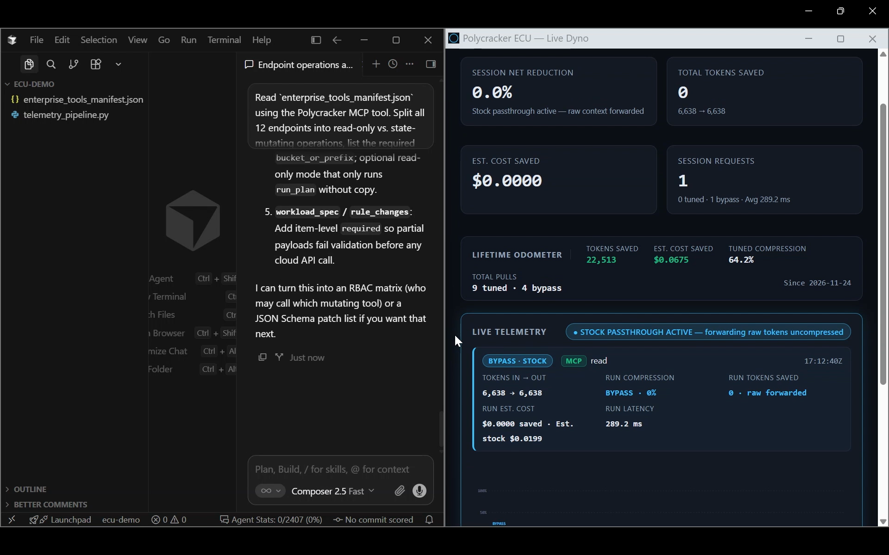
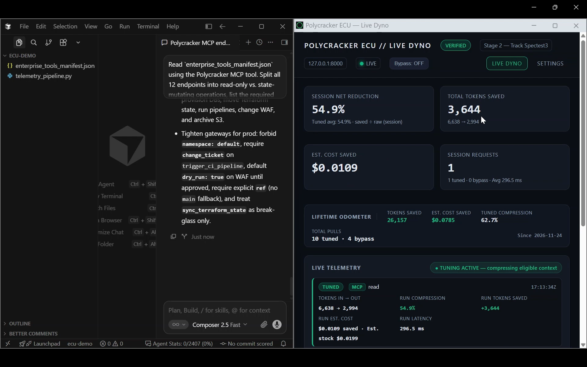
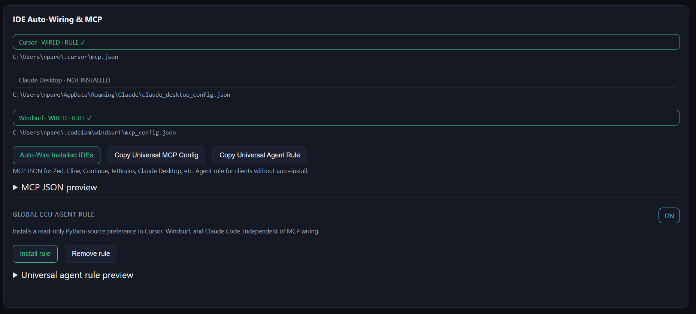
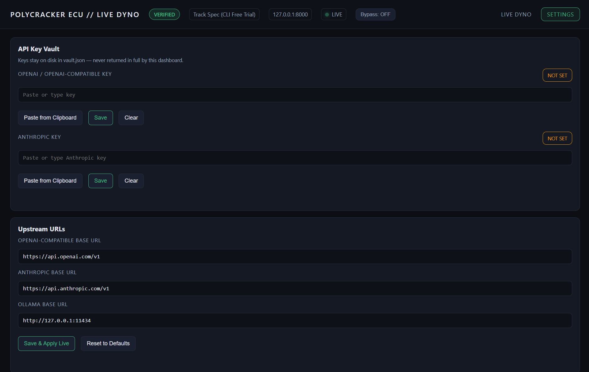
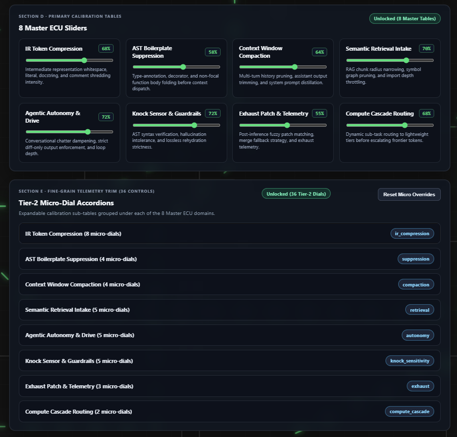
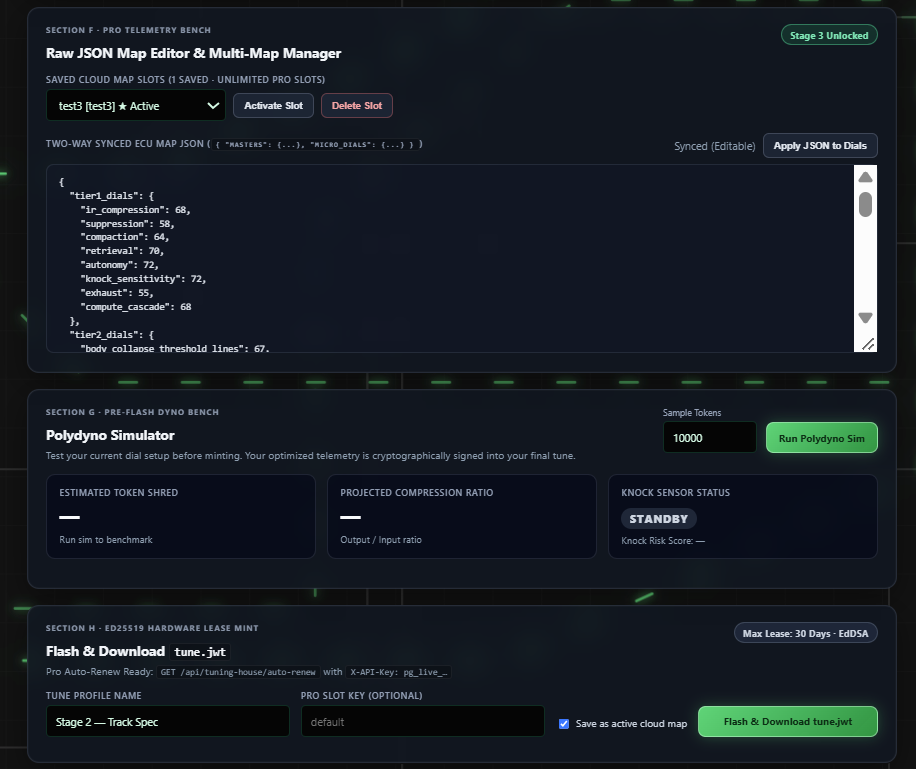
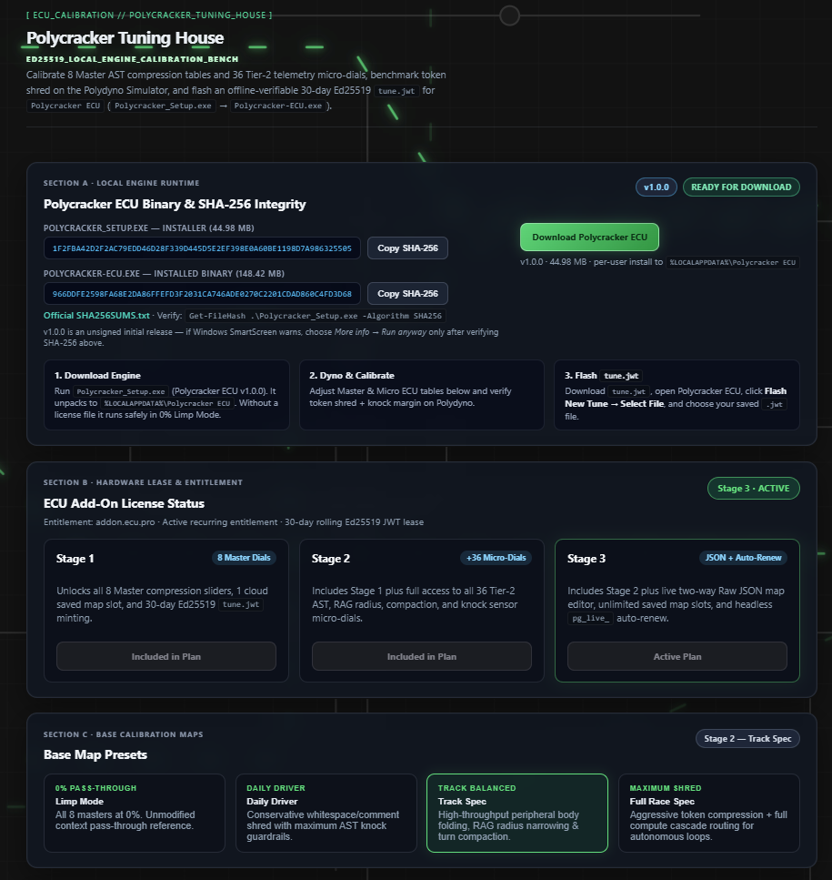

# 🏎️ Polycracker ECU

[](https://pypi.org/project/polycracker-ecu/)
[](#quick-start-windows-x64)
[](#universal-local-hookup)
[](#universal-local-hookup)
[](#license)

**Stop letting blind, one-size-fits-all pruners chop up your context and bill you for the wreckage.**

Most context harnesses hand you a bloated middleware suite with a static trimmer—or worse, an opaque auto-router that uses a second AI model to *guess* which lines of your code and JSON don't matter. When lossy trimming drops a critical detail, their fallback is hoping the LLM notices and pays for a retrieval tool call. Instead, the model hallucinates, fails checks, and falls into **retry loops and extra agent turns**. Every extra turn re-sends conversation history, busts your KV-cache, and generates expensive output tokens—quietly **ballooning your monthly bill** even while a dashboard brags about 90% token savings.

**Polycracker ECU is a precision instrument that puts you in the driver's seat.** Drop it in front of *anything* via the **universal local proxy** (`127.0.0.1:8000`) or plug it straight into your coding agent over **stdio MCP**. No platform sprawl, no cloud relays, no extra tokens burned—just a surgical, zero-bloat local binary delivering strictly deterministic Python AST-to-IR compression and real **knock detection** *(measuring context drift upfront so you catch when aggressive compression is about to strip critical meaning and make the LLM misfire)*—running **100% on your machine**.

We don't sell dashboard vanity metrics or ask you to take 95% claims on faith. Run it against your own repo, your own prompts, and your own provider invoice. Every byte in and every byte out is verifiable.

It ships ready to rip out of the box with a free **30-day Stage 2 Track Spec base tune**—no account required. When you want full manual control instead of auto-magic guessing, sign up for a free **$0** Sandbox account (includes **$5** in Polycracker credits), open the **[Tuning House](https://portal.polycracker.dev/dashboard/tuning-house)** to test **8 macro sliders, 36 micro-dials, raw JSON trimming, and the live Polydyno Simulator**, and upgrade whenever you're ready to export custom offline **Ed25519-signed `tune.jwt`** maps.

---

## 🔌 Universal Local Hookup

Polycracker ECU isn't locked to one IDE or one agent framework. Route any API client, script, or agent through the **local proxy**, or connect directly over **stdio MCP**—your code never leaves your machine.

```text
┌──────────────────────────────────────────────────────────┐
│   ANY IDE / Coding Agent / Script / API Client           │
└───────────────────┬──────────────────────┬───────────────┘
                    │ Universal Local Proxy │ stdio MCP
                    ▼                       ▼
┌──────────────────────────────────────────────────────────┐
│  Polycracker-ECU.exe  (100% Local on Your Machine)       │
│  • Deterministic AST-to-IR Compression                   │
│  • Offline Ed25519-Signed tune.jwt Calibration Map       │
│  • Knock Detection (Upfront Context-Drift Telemetry)     │
└──────────────────────────────┬───────────────────────────┘
                               │ Compressed IR (Zero Extra LLM Burn)
                               ▼
                   Your LLM Provider / Local Model
```

---

## 📊 The Dyno Sheet (Live Capture)

Same prompt, same `enterprise_tools_manifest.json` payload, running live inside Cursor IDE over **stdio MCP**—comparing **Stock Bypass** vs. the included **Stage 2 Track Spec** map:

```text
Workload:         Cursor IDE -> Polycracker MCP read (enterprise_tools_manifest.json)
Stock Bypass:     6,638 -> 6,638 tokens  |  0.0% reduction   |  289.2 ms  |  $0.0000 saved
Stage 2 Tuned:    6,638 -> 2,994 tokens  |  54.9% reduction  |  296.5 ms  |  $0.0109 saved (+3,644 tokens)
Overhead:         +7.3 ms deterministic AST-to-IR pass (0 secondary LLM tokens spent)
```

| Stock Bypass (`BYPASS - STOCK`) | Stage 2 Track Spec (`TUNING ACTIVE`) |
| :---: | :---: |
|  |  |

---

## ⚡ Why Polycracker ECU?

| Dimension | Typical Context Harnesses & Proxies | Polycracker ECU |
| :--- | :--- | :--- |
| **Architecture & Footprint** | Sprawling middleware suites (content routers, shared memory layers, heavy proxies) | **Precision instrument**—a surgical, zero-bloat local binary (`Polycracker-ECU.exe`) that stays out of your way |
| **Compression Engine** | Opaque auto-magic routers mixing heuristics with secondary ML models to guess what to drop | **Deterministic Python AST-to-IR compression**—zero secondary ML guessing, zero extra LLM token burn |
| **Handling Broken Context** | Cuts blind and relies on a retrieval tool—*hoping* the LLM notices missing context and pays for a recovery round-trip | **Prevent the misfire upfront**—real **knock detection** *(context-drift telemetry that flags breakage risk before the model hallucinates or loops)* |
| **Real Invoice Impact** | Loud headline claims ("60–95% fewer tokens") that often backfire via retry loops, extra turns, and higher bills | **Anti-hype, invoice-first**—verify exact token deltas and real provider billing on your own codebase |
| **KV-Cache Protection** | Passive—warns about volatile prefixes without addressing prefix churn | **Prefix-aware**—treats per-turn tax and KV-cache prefix stability as core invoice drivers |
| **Execution & Privacy** | Heavy middleware, cloud relays, or remote APIs | **100% local on your machine** via Universal Proxy + stdio MCP—zero cloud code upload |
| **Calibration & Control** | Static, one-size-fits-all defaults or black-box auto-routing | **Explicit control**—you are the tuner with 8 macro sliders + 36 micro-dials exported as offline `tune.jwt` maps |

---

## 🛠️ Why One-Size-Fits-All Breaks

Nobody puts a locked, factory-stock fuel map on a built engine—so why let an opaque auto-router apply the same static trimmer across completely different workloads?

* **Fragile Legacy Refactors:** Aggressive blind pruning strips comments, type hints, or structural cues, triggering context knock and expensive **retry loops** that erase any input-token savings. Flash a conservative **Daily Driver** tune to keep maximum structural fidelity.
* **Noisy Agent & Tool Dumps:** Agents dumping massive raw JSON payloads and repetitive logs burn through context windows in minutes. Dial up **raw JSON trimming** and aggressive AST stripping to crush per-turn bloat.
* **High-Frequency Multi-Turn Loops:** Unstable prompt prefixes destroy KV-cache hit rates and quietly inflate your bill. Tune your map to protect prefix stability while compressing the payload that actually changes.

---

## 🚀 Quick Start (Windows x64)

1. **Install the open-source CLI wrapper:**

```powershell
pip install polycracker-ecu
```

2. **Download, SHA-256 verify, and extract `Polycracker-ECU.exe` + provision your free 30-day Stage 2 Track Spec trial tune:**

```powershell
polycracker-ecu install
```

3. **Start the local ECU (System Tray / Universal Proxy / stdio MCP):**

```powershell
polycracker-ecu run
```

*(Testing from a local clone? Run `pip install -e .` in step 1.)*

### One-Click IDE Auto-Wiring & Local Proxy Settings

Open the **Settings** tab inside the local ECU dashboard (`127.0.0.1:8000`) to auto-wire **Cursor** and **Windsurf** in one click, copy the **Universal MCP Config** for Zed, Cline, Continue, JetBrains, or Claude Desktop, and configure local **OpenAI, Anthropic, or Ollama** upstream URLs with keys stored strictly on disk in `vault.json`:

| IDE Auto-Wiring & Universal MCP | Local API Key Vault & Upstream URLs |
| :---: | :---: |
|  |  |

---

## 🎛️ The Tuning House & `tune.jwt`

Out of the box, `polycracker-ecu install` provisions a free, balanced **30-day Stage 2 Track Spec** base tune so you can start testing locally right away—no signup required.

When you want explicit control over every parameter instead of black-box auto-magic:

1. **Sign up for the Free $0 Sandbox:** Creating an account at **[Polycracker](https://portal.polycracker.dev/dashboard/tuning-house)** automatically places you on the **$0** Sandbox with **$5** in Polycracker credits—no credit card needed to explore.
2. **Test-Drive the Tuning House & Polydyno Simulator:** Inside the Tuning House, you get full access to **8 Master ECU Sliders**, **36 Tier-2 Micro-Dials**, and the **two-way synced Raw JSON Map Editor**, paired with the **Polydyno Simulator** to preview token shred and knock risk before flashing.
3. **Export Offline `tune.jwt` Maps (Paid Plans):** Exporting and downloading custom **Ed25519-signed `tune.jwt`** calibration files (Stage 1 Master Dials, Stage 2 +36 Micro-Dials, or Stage 3 Raw JSON + Auto-Renew) is available on paid subscription tiers. Once exported, your `tune.jwt` runs **100% offline** on your machine—no phone-home required.
4. **Flash a Custom Map in Seconds:**

```powershell
polycracker-ecu tune --file .\Downloads\tune.jwt
```

| 8 Master ECU Sliders & 36 Micro-Dials | Raw JSON Editor, Polydyno Simulator & `tune.jwt` Mint |
| :---: | :---: |
|  |  |

<details>
<summary><strong>Preview Base Map Presets &amp; Stage 1 / 2 / 3 Calibration Tiers</strong></summary>

<br>



</details>

---

## 🔄 Reopen & Uninstall

Exiting from the system tray stops the active process without deleting your installation or your `tune.jwt`.

* **Reopen after closing the tray:**

```powershell
polycracker-ecu run
```

* **Delete `Polycracker-ECU.exe` and its installed files** *(close from the tray first)*:

```powershell
Remove-Item "$env:USERPROFILE\.polycracker-ecu" -Recurse -Force
```

* **Remove the Python CLI wrapper as well:**

```powershell
pip uninstall polycracker-ecu
```

---

## ⚖️ License

* **CLI wrapper (`src/polycracker_ecu/`):** MIT License.
* **Compiled binary & release assets (`Polycracker-ECU.exe`, `EULA.txt`, `PRIVACY.txt`):** Proprietary — Parrot Integrated Software Development.